

  <a href="https://superhivemarket.com/products/crawlers">
    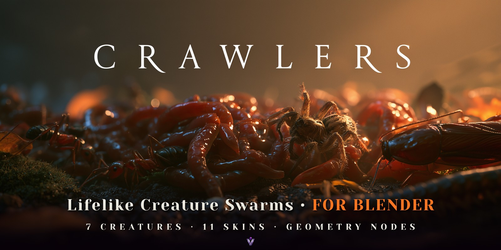
  </a>

# Crawlers

**Lifelike creature swarms for Blender, built in Geometry Nodes.**

Crawlers turns one Geometry Nodes modifier into a living swarm of **earthworms, maggots, centipedes, cockroaches, wolf spiders, ants or snakes**, at their real sizes and moving the way the real animals do. In 1.2 every creature was rebuilt from reference photographs for close-up renders, and snakes joined the swarm.

  <a href="https://superhivemarket.com/products/crawlers"><b>Get Crawlers on Superhive →</b></a>
   
  Blender 5.0+ · Version 1.2.0 · GPL-3.0-or-later

## Rebuilt from photographs

Every creature was rebuilt from reference photographs: furred wolf spiders, spiny cockroach legs, golden hairs on ants, jointed legs that swell between the joints, and wet, ringed earthworms. Insects walk on planted feet with a proper gait, and worms crawl along their own track and pile up.

<table>
  <tr>
    <td width="50%">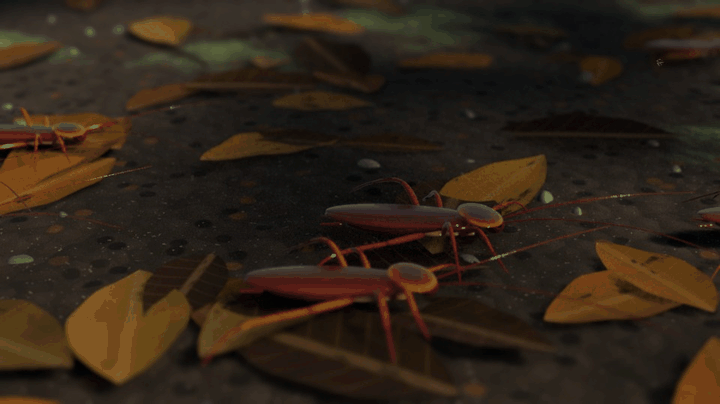</td>
    <td width="50%">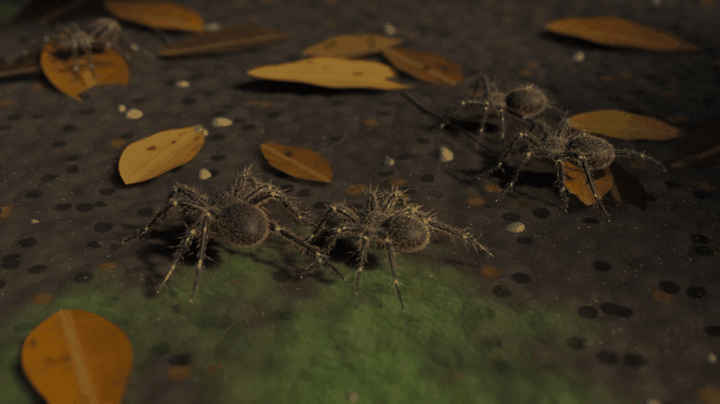</td>
  </tr>
  <tr>
    <td><b>Cockroaches</b> · 3.5 cm. Spiny legs, glossy veined wings, the pale-rimmed pronotum. They dart and freeze on a tripod gait.</td>
    <td><b>Wolf spiders</b> · 1.8 cm body. Furred all over, with pale rings at the joints. They wait in ambush, then dash.</td>
  </tr>
  <tr>
    <td width="50%">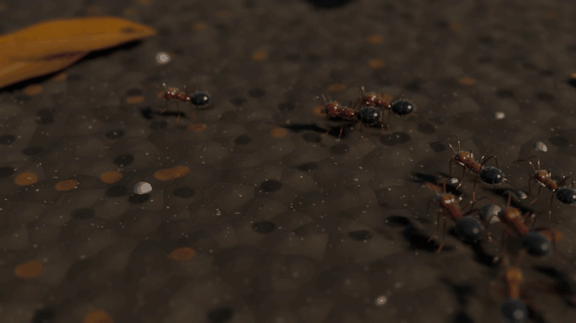</td>
    <td width="50%">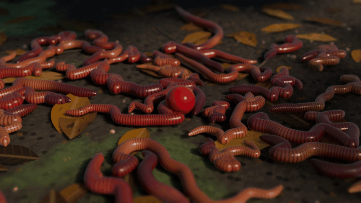</td>
  </tr>
  <tr>
    <td><b>Ants</b> · 1.2 cm. Fine hairs and an iridescent gaster. They march in single file and keep their spacing.</td>
    <td><b>Earthworms</b> · 18 cm. Wet, translucent and ringed. They crawl along their own track and climb over each other into writhing piles.</td>
  </tr>
</table>

Seven creatures, one menu: pick one, and its size, behaviour and skin follow.

| Creature | Length | Natural behaviour |
|---|---|---|
| **Earthworms** | 18 cm | Peristaltic crawl, pile up on whatever they follow |
| **Maggots** | 1.4 cm | Squirming |
| **Centipedes** | 14 cm | Fluid, a rippling wave through 21 pairs of legs |
| **Cockroaches** | 3.5 cm | Dart and freeze, run along walls |
| **Wolf spiders** | 1.8 cm body | Ambush, then dash |
| **Ants** | 1.2 cm | Single file, steady spacing |
| **Snakes** | 90 cm | S-curve glide, tongue flicks |

## Now with snakes

  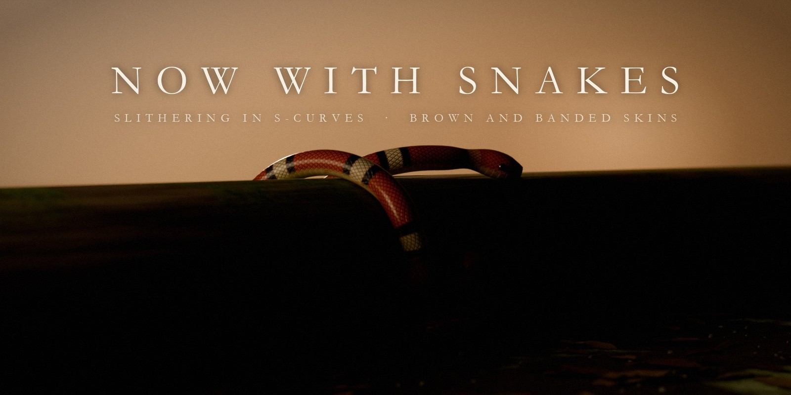

  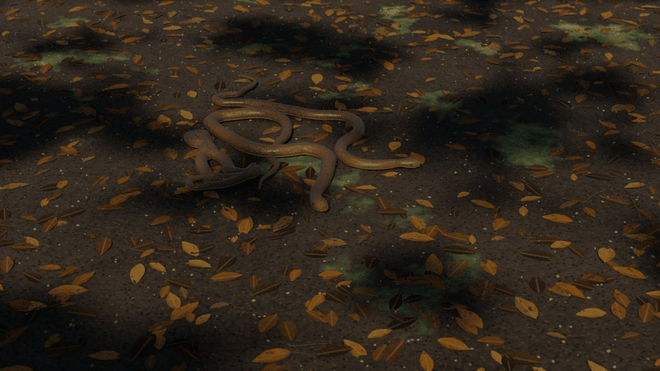

New in 1.2: 90 cm snakes glide in wide S-curves, with the body keeping to the head's track, and flick their forked tongues. They keep a little room around their bodies and check every neighbour for contact, so they don't pass through each other. Two skins: **Brown Snake** and **Banded Snake**, with overlapping scales and wide belly plates.

## They climb over anything

  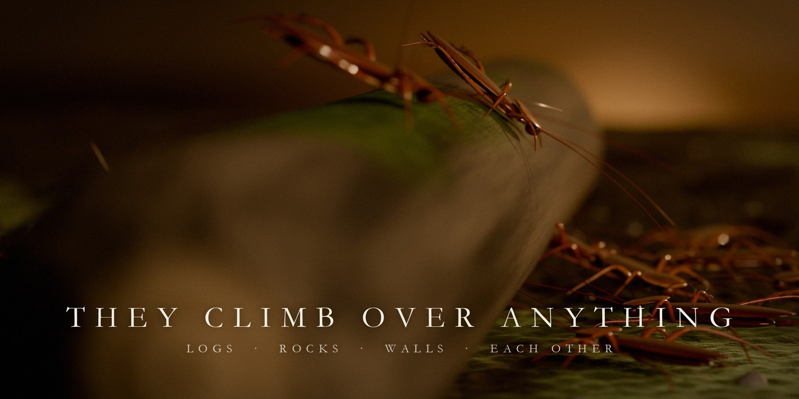

  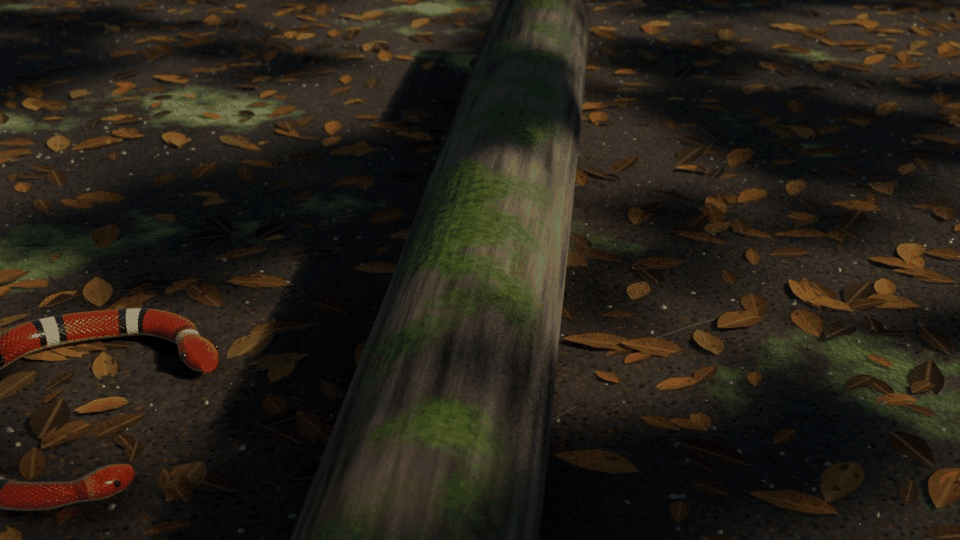

Every creature walks up and over the logs, rocks and walls in its way, overhangs included, and steps down the far side. Select the meshes they should climb, and the swarm treats them as terrain. Even the snakes cross a log side by side without passing through each other.

## The Creature Catalog

  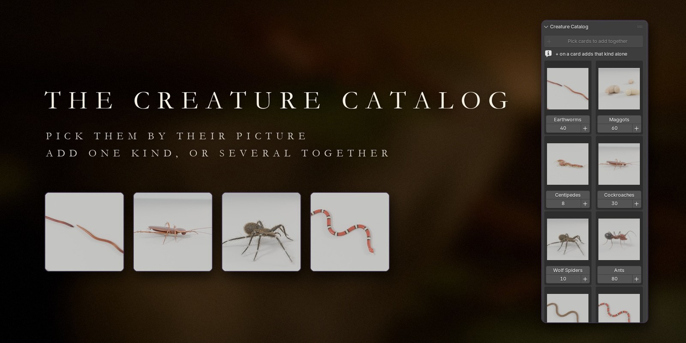

  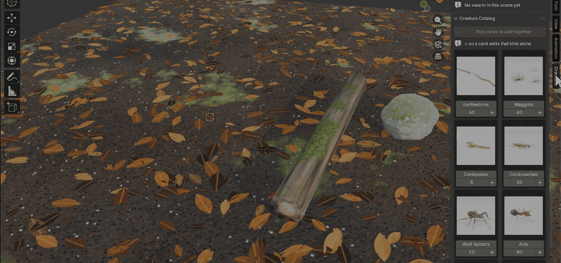

Every creature has a picture card in the sidebar. Click **+** on a card to add that kind alone, or pick several cards and click **Add Together**: one swarm per kind, side by side, all heading for one shared target. Here cockroaches, wolf spiders and ants go together, over the branch.

## Draw their path

  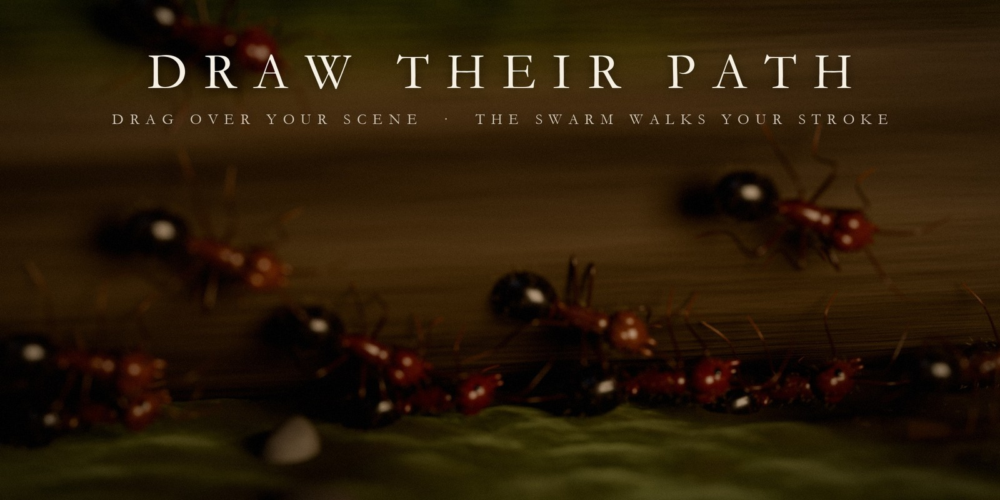

  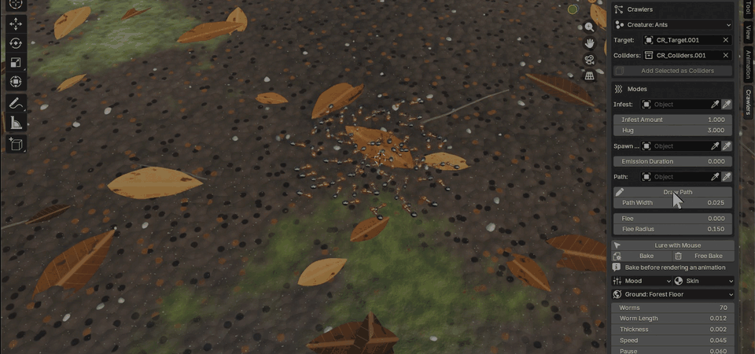

Click **Draw Path** and drag over anything in your scene. The stroke becomes the swarm's route. End it near the start and they walk it round and round. With ants, you get a living ant trail in seconds.

## Lure with Mouse

  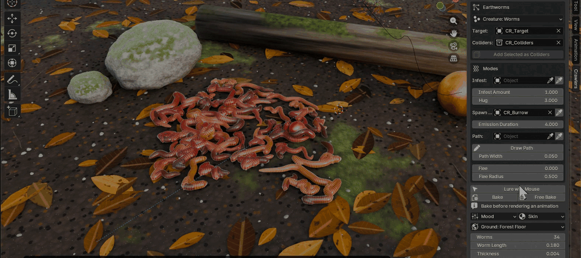

Play the simulation and lead the swarm with your cursor. The worms follow it and pile up where it stops. Hold the left mouse button to blast them apart.

## And more

- **Hunt** any object: an empty, a berry, a lantern, a character's hand. Insects spread around it; worms pile on it.
- **Infest** any mesh: creatures climb onto it and cover it. Animate *Infest Amount* to send them in and call them off.
- **Emerge** from an object (a burrow, a drain, a crack), one after another.
- **Flee** from the target, for example when a light comes on.
- **Burst:** one keyframe and the swarm erupts.
- **Add Ground:** one click puts a detailed procedural floor under the swarm: Forest Floor, Wet Concrete, Old Planks or Stone Tiles.
- **Eleven skins**, from the cockroach's glossy wings to Abyss Glow, Toxic and Leech, and **moods** (Natural, Frenzy, Lazy, Tower Builder).
- **Pure Geometry Nodes:** one simulation zone, fully editable, every mode an ordinary modifier input you can keyframe. One-click background bake.
- **Fast viewport:** lighter geometry while you work, full detail in renders.

## What's included

- The **Crawlers add-on**: a Blender extension (`crawlers-1.2.0.zip`) with the node groups, 11 skins, the ground generator and the catalog pictures.
- **Forest Floor** demo scene: earthworms crawl out of a burrow and pile onto a rolling berry, while an ant trail crosses a mossy branch to an apple.
- **The Undercroft** demo scene: stylised giant glowing worms emerge from a drain, hunt a lantern, bury a statue and flee when the lantern flares.
- Documentation.

The add-on and the demo scenes are available on **[Superhive](https://superhivemarket.com/products/crawlers)**.

## Requirements

Blender **5.0 or newer**. Tested on Blender 5.0.1 and 5.2.0 LTS.

## Installation

1. Get `crawlers-1.2.0.zip` from [Superhive](https://superhivemarket.com/products/crawlers).
2. In Blender, go to *Edit → Preferences → Get Extensions*, open the ⌄ menu, choose **Install from Disk…** and pick the zip. You can also drag the zip into Blender.
3. A **Crawlers** tab appears in the 3D Viewport sidebar (press **N**).

## Quick start

1. Select the meshes the creatures should climb on (rocks, logs, walls). The floor is built in.
2. Click **+** on a card in the **Creature Catalog**, or pick several cards and click **Add Together**.
3. Click **Add Ground** and pick a style.
4. Press Play. The swarm goes for `CR_Target`: move it, click **Lure with Mouse**, or click **Draw Path** and drag over the scene.
5. Before rendering an animation, click **Bake**.

Sizes are real, so a swarm of ants is only a few centimetres across: zoom in, or scale *Worm Length* up for stylised giants.

> [!NOTE]
> The creature loops on this page are EEVEE renders. The viewport loops (Creature Catalog, Draw Path, Lure with Mouse) were recorded frame by frame, partly at double speed. Live playback speed depends on the creature count and your hardware.

## License

Crawlers is released under the **GNU General Public License v3.0 or later** (GPL-3.0-or-later): the add-on code, the `.blend` assets and the demo scenes.

© 2026 Voyde Procedural
